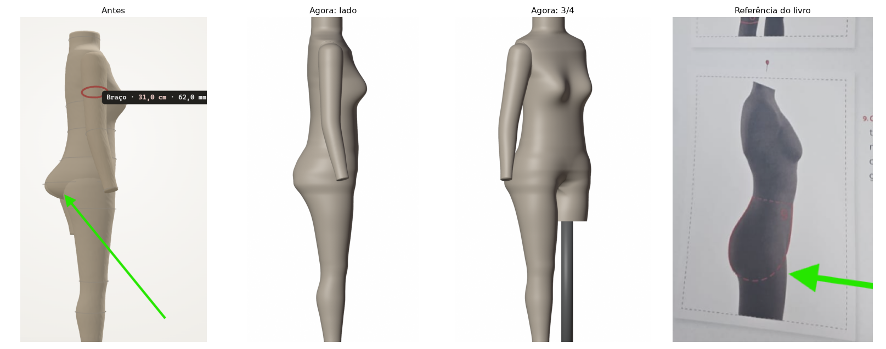

# Maniquim: gerador de manequim de moulage paramétrico

Gera manequins de moulage em escala (1:4, 1:5, 1:6, 1:8) no formato **perna longa**: tronco com perna inteira, coto da outra perna e braço removível. Os manequins saem a partir de uma tabela de medidas do corpo, igual às usadas em modelagem de vestuário, e as peças saem prontas para impressão 3D.



## Pastas

| Pasta | O que é |
|---|---|
| [`gerador_manequim/`](gerador_manequim/) | **Gerador e plataforma web.** Planilha de medidas, prévia 3D ao vivo, corpos-base feminino e masculino, geração dos STL e prancha de conferência. Veja o [LEIA-ME](gerador_manequim/LEIA-ME.md). |
| [`gerador_manequim/saida/Giovanna/`](gerador_manequim/saida/Giovanna/) | Manequim da Giovanna em 1:5 (versão atual): STL das peças, prancha PDF/PNG e relatório de medidas. |
| [`manequim_giovanna_1-5/`](manequim_giovanna_1-5/) | Primeira versão, feita antes do gerador (histórico). |

## Início rápido

Precisa de Python 3 com `numpy`, `matplotlib` e `openpyxl`, e do Blender 4.2 ou mais novo.

```bash
cd gerador_manequim
python servidor.py
```

O navegador abre em `http://localhost:8770`. Outra opção é rodar `Abrir gerador.bat` no Windows. Para usar só pela linha de comando:

```bash
cd gerador_manequim
python gerar.py --pessoa Giovanna
```

## Como funciona

- **Medidas:** a planilha segue a tabela da cliente, com contornos, alturas e as outras medidas. O gerador confere a coerência entre as medidas (por exemplo, cintura ao solo × entrepernas + gancho e altura da cava) e estima as que faltam.
- **Corpo:** os corpos-base feminino e masculino são deformados pelas alturas da pessoa. Uma calibração automática ajusta os contornos (busto, cintura, quadris, pescoço, coxa, joelho, panturrilha, tornozelo, braço, cotovelo e pulso) até baterem com a tabela.
- **Geometria:** o corpo é um campo de distância com união suave entre tronco e pernas (OpenVDB, dentro do Blender). Seios e glúteos são volumes próprios, e o glúteo continua na parte de trás da coxa.
- **Saídas:** STL das peças (tronco e perna, braço com 2 pinos de 2 mm, base e haste de 10 mm), prancha de conferência em PDF/PNG e relatório JSON.
- **Plataforma web:** usa o mesmo corpo do arquivo final, numa resolução mais baixa, para a prévia ao vivo.
